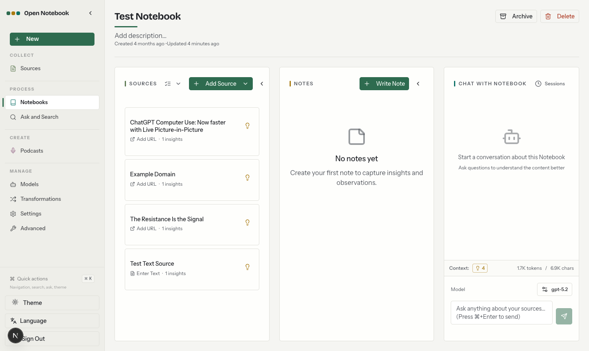

# 研证 · AI 科研与论文辅助工作台

基于 **[Open Notebook v1.15.0](https://github.com/lfnovo/open-notebook/tree/v1.15.0)** 完整产品适配，固定上游提交 `315d5255af2a5132aada41c94d5c3c5dc8e837aa`。保留 Next.js 前端、FastAPI、SurrealDB、处理队列及 MIT 许可；围绕用户自己的研究问题，提供 AI 联网查阅公开网页、真实文献发现、资料整理、带原文定位的辅助阅读、论文草稿与版本导出，并保留独立人审及过程记录。不预置参赛案例，不把上游功能冒充自研。

## 公开源码说明

本仓库发布工作台源码快照，保留上游 MIT 许可及归属，不包含开发者的 `.env`、登录凭据、研究数据库、上传论文、模型缓存或参赛媒体。使用者需要自行安装下述依赖、配置自己的模型服务或已登录的 OMP；公开源码不提供模型账号、API 额度或团队站点密码。模型调用可能产生费用。

首次公开发布已关闭 GitHub Actions，避免继承的上游镜像发布工作流误触发；需要 CI 时，应先审核 `.github/workflows/` 的发布目标及所需 secrets，再自行启用。

## 直接使用

macOS 安装下述首次运行依赖后，在访达中双击 **`启动研证.command`**，等待提示就绪，浏览器会打开：

**http://127.0.0.1:3000/research**

保留启动窗口；结束时按 `Ctrl+C`，关闭本次启动的服务。不会停止其它程序，也不需要先开 Docker。若提示端口被占用，先关闭上一次的研证启动窗口，不要重复启动。

首次在新机器运行需要 Node.js 和 uv；Python 3.12 由 uv 管理。本机验证环境为 Node.js 24.15 / Python 3.12.13。首次联网安装锁定依赖、下载校验后的数据库及约 220 MB 的公开多语言向量权重，后续使用本地缓存。

终端等价入口（在本目录）：

```bash
uv run --locked --python 3.12 python scripts/start_research.py
```

开发模式加 `--dev`；只准备数据库及环境、不启动服务加 `--prepare-only`。故障日志在 `.runtime/logs/`。

## kaijie.store 团队子站

部署入口：**https://kaijie.store/yanzheng/**。使用管理员单独交付的工作台密码登录；服务器预配置 GPT 反代后，无须点击“启用本人本机账号”。没有把本机 OMP 登录态、研究数据库或论文同步到公网。

这是**可信团队共用工作台**，不是每人独立账户：持有同一密码的人可以查看、编辑全部研究与模型设置，也会消耗同一 GPT 上游额度。不要向不可信访客分享密码；论文、网页及问题经明确授权后仍会发送到所选外部模型。

- 配置：`deploy/kaijie/compose.yaml` 与 `deploy/kaijie/yanzheng.conf`。镜像构建参数 `NEXT_PUBLIC_BASE_PATH=/yanzheng`；运行时 `API_URL=https://kaijie.store/yanzheng`。更换前缀必须重新构建，不能只改反向代理。
- Next.js 保留 `/yanzheng` 前缀处理资源、登录和网络请求，内部 FastAPI 仍用 `/api`。只新增主站已有 include 下的 `yanzheng.conf`，不接管主站 `/api`、`/login` 或 `/config`。
- 应用以前台 `127.0.0.1:8502`、API `127.0.0.1:5055` 监听；独立 SurrealDB 映射至 `127.0.0.1:18002`，不向公网发布原始 API 或数据库端口。应用与数据库以非 root UID 10001、只读镜像和独立数据目录运行。
- 数据保存在服务器 `/var/lib/yanzheng/app` 与 `/var/lib/yanzheng/database`；权限受限的 `/etc/yanzheng/runtime.env` 保存密码、数据库凭据和加密密钥。备份应同时包含两份数据与加密配置；不要将它们提交到仓库。
- GPT 复用服务器既有 `http://127.0.0.1:18080/v1` 私有代理，下游 API Key 只在服务端加密保存；不读取或迁移代理的 OAuth 凭据，也不新增公网 `/v1`。代理的实际可用模型需实连核对，模型列表不等于推理成功。
- 此代理只兼容部分 OpenAI 参数，研究回答继续使用提示词 JSON 和本地严格校验，不把 `response_format` 或输出 token 参数当作上游硬保证。应用不自动重发失败调用；上游代理可能自行重试，不能承诺整条调用链零重试。
- Linux 过程 PDF 使用镜像内合法分发的文泉驿正黑 TrueType 字体；通过 `RESEARCH_PREVIEW_BODY_FONT`、`RESEARCH_PREVIEW_HEADING_FONT` 指定，集合使用第零字体。它只是过程预览，不冒充赛事要求的宋体/黑体；正式参赛字体校验没有放宽。
- 发布版本放在服务器 `/opt/yanzheng/releases/`，保留镜像标签及旧版本；更新前备份独立数据。回退应用镜像不自动回退数据库结构，涉及迁移时需配套恢复备份。

生产启动（服务器内，环境文件不回显）：

```bash
docker compose --env-file /etc/yanzheng/runtime.env \
  -f /opt/yanzheng/current/deploy/kaijie/compose.yaml up -d
```

首次模型初始化在服务器内执行 `python3 /opt/yanzheng/current/deploy/kaijie/configure_models.py --model gpt-5.6-luna`。脚本只读取服务器下游代理 Key、创建加密凭据并补齐空默认项，不读取 OAuth、不打印密钥、不覆盖已有默认模型，也不自动推理。公开向量权重需由管理员显式运行 `docker compose --env-file /etc/yanzheng/runtime.env -f /opt/yanzheng/current/deploy/kaijie/compose.yaml exec -T app uv run --no-sync python -c "from open_notebook.ai.local_embedding import prepare_embedding; prepare_embedding(allow_download=True)"` 下载到独立数据卷。

## 第一次怎么操作

1. **写问题，创建研究。** 首页输入自己的研究问题，资源限制可选填。创建项目不会调用 AI；历史研究在“历史与归档”中查看，不会作为默认案例塞入新研究。
2. **连接 AI。** 团队子站直接使用管理员已配置的默认 GPT；本机入口可点击“启用本人本机账号与本地检索”，复用本机 OMP 已登录账号，不读取或复制登录令牌。使用自己的 API 时，在高级模型管理配置供应商及默认语言模型。
3. **让 AI 找资料。** 直接了解问题可先用“联网查阅”，输入问题并授权，系统搜索、读取公开网页，再给出带原句和链接的回答。需要学术书目、摘要及开放论文时，用“文献发现”制定策略并检索 OpenAlex，Crossref 可选；模型不能凭空生成书目。每次真实模型调用可能消耗账号额度。
4. **纳入需要的资料。** 选择检索结果纳入，系统自动保存书目、可用摘要及采用记录，并尝试下载允许来源的开放 PDF。没有全文就明确保留为摘要或书目，不冒充已读。手动上传仅为补充，无需先上传文件或逐项重抄书目。
5. **直接辅助阅读。** 在“辅助阅读”选择资料、输入想弄清的问题，明确本次发送授权后生成阅读记录。系统自动选取正文片段或使用摘要，展示实际物理页、覆盖范围和原句；不必先手动逐页选择，也不要求先把书目标成人工确认。一次最多八份资料、24,000 字符；片段阅读不等于通读全文。
6. **形成并修改论文草稿。** 在“论文辅助写作”选择提纲、引用段落或已有草稿改写，说明要求并生成。提纲可以没有文献，但不会冒充已有证据；引用段落使用已保存资料及实际发送的原句。人工编辑保存为新版本，历史不覆盖。未保存编辑有离页提醒，并在本标签页保留恢复缓冲，后退再进入时恢复原版本的标题与正文；暂存不等于保存，浏览器拒绝暂存时会明确警告。问题或资料已变更时旧稿保留，但不能冒作当前成果。
7. **下载可继续加工的文件。** 写作版本可下载 Word、Markdown 和 BibTeX 参考文献。书目由实际来源生成，不由模型编造；草稿、引文匹配和相关性建议都不等于人工认可，也不保证创新性或研究结论正确。
8. **按需核验并保留过程。** “研究记录与按需核验”保留检索、模型调用、阅读覆盖和写作版本链；可下载过程 JSON、证据矩阵 CSV 与过程 PDF。关键主张可以深入对照原文、修订书目并独立判断，不阻塞明确标识的辅助读写草稿。正式赛事文件仍须团队核对事实、匿名性、引用与 AI 使用披露。

“打开原生资料 · 聊天 · 笔记”保留 Open Notebook 原有工作区。同一论文可用于有来源的问答和笔记；需要语义检索时，在来源详情的“详情”页显式点击“嵌入内容”，再使用向量搜索。聊天答案、笔记和机器检索结果不会自动变为人工核验的正式证据。

## AI 联网查阅

进入自己的研究，在“研究问题”下面找到 **“联网查阅”**：

1. 输入想了解的问题，可以直接用中文；无需先上传 PDF 或自己整理书目。
2. 勾选本次授权，点击 **“AI 联网查阅（搜索、阅读并回答）”**。问题与检索词会发送给公开搜索服务，实际取得的网页片段会发送给当前模型；不会读取浏览器 Cookie 或登录账号。
3. 查看回答下面的原句、来源链接和查阅时间。展开“实际读取范围与未读原因”，可检查已取得的待用片段及回答调用记录；取得片段不代表已送达模型，失败调用也不保证服务端已接收。“检索词与候选网页”中的搜索摘要不算已读正文。

本次通常有两次模型调用：拟定至多两条查询，再依据真实正文回答。最多尝试四个候选网页，每页只发送提取文本的前 6,000 字符，总计不超过 24,000 字符。没有取得正文时不让模型凭记忆生成联网回答。刷新、查看历史或展开来源不会重复调用模型；失败也保留已取得的检索、网页及真实调用记录，先检查状态再手动重试。

当前无须额外搜索密钥，使用 Bing 公开 HTML 搜索，**不是稳定承诺的官方搜索 API**。实际测试中短英文专有术语能返回相关来源，长中文问句的匹配可能明显偏题；模型会先提炼关键词，但仍需自行核对相关性。页面结构改变、限流、验证码、登录/订阅墙、动态脚本页或不可读编码会明确失败，不悄悄换源或绕过限制。需要中文学术文献时，不能把它当成知网等数据库的替代品。

网页查阅独立记录，不伪装成论文摘要、PDF页码或已经人工核验的资料，也不会自动加入论文引用。研究问题换版后旧查阅保留为历史。过程导出包含查询、来源 URL、实际读取范围、输入哈希、失败及调用关联，不包含整段网页正文或模型原始回答；对论文的采用与核验仍由你决定。

## 数据、模型与使用边界

- `启动研证.command` 本机模式只监听网页 `3000`、API `5055`、数据库 `8000`，并检查原始 Host/Origin，防止前端代理把跨站请求洗成可信模型调用。公网团队子站使用上节独立部署和密码保护，不把本机启动命令直接暴露到公网。
- 研究按笔记本隔离在 `data/competition/`，原生资料在 `data/uploads/`，数据库在 `data/surreal/`。`.env` 首次自动生成且权限为 `0600`；不要删除其中的加密密钥，否则已有 API 凭据将无法解密。
- 未保存写作缓冲仅存于当前浏览器标签页的 `sessionStorage`，按研究隔离；不会当作已保存版本或自动发给模型。保存新版本或明确放弃会清除缓冲；关闭标签页后不保证恢复，重要内容请及时保存。
- OMP 使用本人现有登录调用远程模型，**不是离线推理**。回答完成后一次返回，不是假装实时逐字流。请求失败时先刷新状态查看是否已有结果，不要立即重复付费调用。
- 文献发现只覆盖所选公开数据源，不代表检索全网、知网或全部中文文献。搜索失败、限流及全文获取失败如实显示，不暗中重试、换源或绕过付费墙。自动 PDF 下载限 HTTPS 公网白名单域名，逐跳验证重定向并固定连接地址，关闭环境代理。
- 每份 PDF 最多 20 MiB / 100 页，每个研究最多 20 份；扫描件无文本层时不假读。解析在不继承模型凭据的一次性子进程中完成，限制时间、CPU、内存、解压量及输出；失败不保存半份材料。真实正文、摘要与仅书目三个层级始终区分。
- 检索向量使用真实本地多语言 ONNX：`sentence-transformers/paraphrase-multilingual-MiniLM-L12-v2`，384 维，CPU 两线程。按模型的实际 token 窗口处理全文并聚合，不静默丢掉长段落后文。日常嵌入不外网下载；这不代表语义匹配本身经过了科研质量评价。
- 旧 SMS 实验只作为已有研究的历史记录保留，不作为新研究的模板或必经步骤。其预设管道及结果不外推为其他领域、中文反诈或生产系统效果。
- 修改问题、书目或人工判断会使相关旧正式决定失效；原 PDF、实验或数据哈希不符时也不能保留正式资格。历史过程保留，不自动重跑模型或改签人审。
- `process.pdf` 是研究过程，不是赛事限 1000 字的正式提交说明。视频、正式参赛 PDF、身份匿名复查和赛事提交由团队完成，本软件不代签、不自动上传。
- 上游保留的播客、联网采集等功能需要各自供应商配置；本工作台主路径为“研究问题→文献发现→资料纳入→辅助阅读→写作与修改→导出及过程追溯”。

## 旧数据与 GitHub 交接

原 `../research_agent` 的应用代码和研究数据保持不变，仅更新实施路线图。本机迁入的两份真实论文和四张未复核证据保留在历史归档研究中，没有代签为支持，也不会自动填入用户新建的研究。迁移程序使用 SQLite 只读备份，不复制旧账户配置；重复运行不会重复导入：

```bash
uv run --locked --env-file .env python scripts/import_legacy.py ../research_agent/data
```

发布自己的仓库时保留 `LICENSE` 和上游归属；只提交源码、锁文件和脱敏示例配置，**不要提交 `.env`、`data/`、`.runtime/`、`artifacts/` 或任何账户令牌**，这些路径已加入忽略规则。上游 Git remote 仍指向原项目，推送前须换成自己的仓库，避免误推上游。不要把个人研究材料或模拟验收记录当作公开样例成果。

## 开发验证

在本目录执行完整后端回归，GitHub 测试流程也包含赛事核心：

```bash
uv run --locked pytest --import-mode=importlib tests competition_tests
```

在 `frontend/` 执行 `npm test -- --maxWorkers=2` 和 `npx tsc --noEmit`。真实本地向量集成另需先准备权重缓存，并在后端命令前设置 `RUN_LOCAL_EMBEDDING_INTEGRATION=1`；不启用该标志时不会为测试自动联网下载。


---

## Open Notebook 上游原始说明

<a id="readme-top"></a>

<!-- [![Contributors][contributors-shield]][contributors-url] -->
[![Forks][forks-shield]][forks-url]
[![Stargazers][stars-shield]][stars-url]
[![Issues][issues-shield]][issues-url]
[![MIT License][license-shield]][license-url]
<!-- [![LinkedIn][linkedin-shield]][linkedin-url] -->


<!-- PROJECT LOGO -->
<br />
<div align="center">
  <a href="https://github.com/lfnovo/open-notebook">
    
  </a>

  <h3 align="center">Open Notebook</h3>

  <p align="center">
    An open source, privacy-focused alternative to Google's Notebook LM!
    <br /><strong>Join our <a href="https://discord.gg/37XJPXfz2w">Discord server</a> for help, to share workflow ideas, and suggest features!</strong>
    <br />
    <a href="https://www.open-notebook.ai"><strong>Checkout our website »</strong></a>
    <br />
    Follow <a href="https://x.com/lfnovo">@lfnovo on X</a> for updates
    <br />
    <br />
    <a href="docs/0-START-HERE/index.md">📚 Get Started</a>
    ·
    <a href="docs/3-USER-GUIDE/index.md">📖 User Guide</a>
    ·
    <a href="docs/2-CORE-CONCEPTS/index.md">✨ Features</a>
    ·
    <a href="docs/1-INSTALLATION/index.md">🚀 Deploy</a>
  </p>
</div>

<p align="center">
<a href="https://trendshift.io/repositories/14536" target="_blank"></a>
</p>

<div align="center">
  <!-- Keep these links. Translations will automatically update with the README. -->
  <a href="https://zdoc.app/de/lfnovo/open-notebook">Deutsch</a> | 
  <a href="https://zdoc.app/es/lfnovo/open-notebook">Español</a> | 
  <a href="https://zdoc.app/fr/lfnovo/open-notebook">français</a> | 
  <a href="https://zdoc.app/ja/lfnovo/open-notebook">日本語</a> | 
  <a href="https://zdoc.app/ko/lfnovo/open-notebook">한국어</a> | 
  <a href="https://zdoc.app/pt/lfnovo/open-notebook">Português</a> | 
  <a href="https://zdoc.app/ru/lfnovo/open-notebook">Русский</a> | 
  <a href="https://zdoc.app/zh/lfnovo/open-notebook">中文</a>
</div>

## A private, multi-model, 100% local, full-featured alternative to Notebook LM



In a world dominated by Artificial Intelligence, having the ability to think 🧠 and acquire new knowledge 💡, is a skill that should not be a privilege for a few, nor restricted to a single provider.

**Open Notebook empowers you to:**
- 🔒 **Control your data** - Keep your research private and secure
- 🤖 **Choose your AI models** - Support for 18+ providers including OpenAI, Anthropic, Ollama, LM Studio, and more
- 📚 **Organize multi-modal content** - PDFs, videos, audio, web pages, and more
- 🎙️ **Generate professional podcasts** - Advanced multi-speaker podcast generation
- 🔍 **Search intelligently** - Full-text and vector search across all your content
- 💬 **Chat with context** - AI conversations powered by your research
- 🌐 **Multi-language UI** - English, Portuguese, Chinese (Simplified & Traditional), Japanese, Russian, and Bengali support

Learn more about our project at [https://www.open-notebook.ai](https://www.open-notebook.ai)

---

## 🆚 Open Notebook vs Google Notebook LM

| Feature | Open Notebook | Google Notebook LM | Advantage |
|---------|---------------|--------------------|-----------|
| **Privacy & Control** | Self-hosted, your data | Google cloud only | Complete data sovereignty |
| **AI Provider Choice** | 18+ providers (OpenAI, Anthropic, Ollama, LM Studio, etc.) | Google models only | Flexibility and cost optimization |
| **Podcast Speakers** | 1-4 speakers with custom profiles | 2 speakers only | Extreme flexibility |
| **Content Transformations** | Custom and built-in | Limited options | Unlimited processing power |
| **API Access** | Full REST API | No API | Complete automation |
| **Deployment** | Docker, cloud, or local | Google hosted only | Deploy anywhere |
| **Citations** | Basic references (will improve) | Comprehensive with sources | Research integrity |
| **Customization** | Open source, fully customizable | Closed system | Unlimited extensibility |
| **Cost** | Pay only for AI usage | Free tier + Monthly subscription | Transparent and controllable |

**Why Choose Open Notebook?**
- 🔒 **Privacy First**: Your sensitive research stays completely private
- 💰 **Cost Control**: Choose cheaper AI providers or run locally with Ollama
- 🎙️ **Better Podcasts**: Full script control and multi-speaker flexibility vs limited 2-speaker deep-dive format
- 🔧 **Unlimited Customization**: Modify, extend, and integrate as needed
- 🌐 **No Vendor Lock-in**: Switch providers, deploy anywhere, own your data

### Built With

[![Python][Python]][Python-url] [![Next.js][Next.js]][Next-url] [![React][React]][React-url] [![SurrealDB][SurrealDB]][SurrealDB-url] [![LangChain][LangChain]][LangChain-url]

## 🚀 Quick Start (2 Minutes)

### Prerequisites
- [Docker Desktop](https://www.docker.com/products/docker-desktop/) installed
- That's it! (API keys configured later in the UI)

### Step 1: Get docker-compose.yml

**Option A:** Download directly
```bash
curl -o docker-compose.yml https://raw.githubusercontent.com/lfnovo/open-notebook/main/docker-compose.yml
```

**Option B:** Create the file manually
Copy this into a new file called `docker-compose.yml`:

```yaml
services:
  surrealdb:
    image: surrealdb/surrealdb:v2
    # Credentials default to root:root for a zero-config local setup. Before
    # exposing this instance to a network, set SURREAL_USER / SURREAL_PASSWORD
    # in a .env file (see .env.example) — they are applied here and to the
    # open_notebook service below, so the two always stay in sync.
    # List (exec) form so each interpolated value stays a single argument —
    # a password containing spaces would otherwise be split into several.
    command: ["start", "--log", "info", "--user", "${SURREAL_USER:-root}", "--pass", "${SURREAL_PASSWORD:-root}", "rocksdb:/mydata/mydatabase.db"]
    user: root  # Required for bind mounts on Linux
    ports:
      # Bound to localhost only: the open_notebook service reaches this over
      # the internal compose network regardless, so the host port is purely
      # for local debugging (e.g. Surrealist, `surreal sql`). Exposing this
      # on 0.0.0.0 would let anyone who can reach the host connect with the
      # default root:root credentials.
      - "127.0.0.1:8000:8000"
    volumes:
      - ./surreal_data:/mydata
    environment:
      - SURREAL_EXPERIMENTAL_GRAPHQL=true
    restart: always
    pull_policy: always

  open_notebook:
    image: lfnovo/open_notebook:v1-latest
    ports:
      - "8502:8502"  # Web UI
      - "5055:5055"  # REST API
    environment:
      # REQUIRED: Change this to your own secret string
      # This encrypts your API keys in the database
      - OPEN_NOTEBOOK_ENCRYPTION_KEY=change-me-to-a-secret-string

      # Database connection. SURREAL_USER / SURREAL_PASSWORD default to root:root
      # for local use; override them in a .env file before exposing the instance
      # (the same values configure the surrealdb service above).
      - SURREAL_URL=ws://surrealdb:8000/rpc
      - SURREAL_USER=${SURREAL_USER:-root}
      - SURREAL_PASSWORD=${SURREAL_PASSWORD:-root}
      - SURREAL_NAMESPACE=open_notebook
      - SURREAL_DATABASE=open_notebook
    volumes:
      - ./notebook_data:/app/data
    depends_on:
      - surrealdb
    restart: always
    pull_policy: always
```

### Step 2: Set Your Encryption Key
Edit `docker-compose.yml` and change this line:
```yaml
- OPEN_NOTEBOOK_ENCRYPTION_KEY=change-me-to-a-secret-string
```
to any secret value (e.g., `my-super-secret-key-123`)

### Step 3: Start Services
```bash
docker compose up -d
```

Wait 15-20 seconds, then open: **http://localhost:8502**

### Step 4: Configure AI Provider
1. Go to **Models** and choose your provider (OpenAI, Anthropic, Google, etc.)
2. Click **+ Add Configuration**
3. Paste your API key and other info as needed and click **Add Configuration**
4. Click **Test** to test connection
5. Click **Sync Models** and check models to include
6. Under **Default Model Assignments**, click **Auto-Assign Defaults** or manually specify which models to use for what 

Done! You're ready to create your first notebook.

> **Need an API key?** Get one from:
> [OpenAI](https://platform.openai.com/api-keys) · [Anthropic](https://console.anthropic.com/) · [Google](https://aistudio.google.com/) · [Groq](https://console.groq.com/) (free tier)

> **Want free local AI?** See [examples/docker-compose-ollama.yml](examples/) for Ollama setup

---

### 📚 More Installation Options

- **[With Ollama (Free Local AI)](examples/docker-compose-ollama.yml)** - Run models locally without API costs
- **[From Source (Developers)](docs/1-INSTALLATION/from-source.md)** - For development and contributions
- **[Complete Installation Guide](docs/1-INSTALLATION/index.md)** - All deployment scenarios

---

### 📖 Need Help?

- **🤖 AI Installation Assistant**: [CustomGPT to help you install](https://chatgpt.com/g/g-68776e2765b48191bd1bae3f30212631-open-notebook-installation-assistant)
- **🆘 Troubleshooting**: [5-minute troubleshooting guide](docs/6-TROUBLESHOOTING/quick-fixes.md)
- **💬 Community Support**: [Discord Server](https://discord.gg/37XJPXfz2w)
- **🐛 Report Issues**: [GitHub Issues](https://github.com/lfnovo/open-notebook/issues)

---

## Star History

[](https://star-history.dera.page/#lfnovo/open-notebook&type=date&legend=top-left)


## Provider Support Matrix

Thanks to the [Esperanto](https://github.com/lfnovo/esperanto) library, we support this providers out of the box!

| Provider     | LLM Support | Embedding Support | Speech-to-Text | Text-to-Speech |
|--------------|-------------|------------------|----------------|----------------|
| OpenAI       | ✅          | ✅               | ✅             | ✅             |
| Anthropic    | ✅          | ❌               | ❌             | ❌             |
| Groq         | ✅          | ❌               | ✅             | ❌             |
| Google (GenAI) | ✅          | ✅               | ✅             | ✅             |
| Vertex AI    | ✅          | ✅               | ❌             | ✅             |
| Ollama       | ✅          | ✅               | ❌             | ❌             |
| oMLX         | ✅          | ✅               | ❌             | ❌             |
| Perplexity   | ✅          | ❌               | ❌             | ❌             |
| ElevenLabs   | ❌          | ❌               | ✅             | ✅             |
| Deepgram     | ❌          | ❌               | ✅             | ✅             |
| Azure OpenAI | ✅          | ✅               | ✅             | ✅             |
| Mistral      | ✅          | ✅               | ✅             | ✅             |
| DeepSeek     | ✅          | ❌               | ❌             | ❌             |
| Cohere       | ✅          | ✅               | ❌             | ❌             |
| Voyage       | ❌          | ✅               | ❌             | ❌             |
| xAI          | ✅          | ❌               | ❌             | ✅             |
| OpenRouter   | ✅          | ✅               | ✅             | ✅             |
| DashScope (Qwen) | ✅          | ❌               | ❌             | ❌             |
| MiniMax      | ✅          | ❌               | ❌             | ✅             |
| Novita       | ✅          | ❌               | ❌             | ❌             |
| SiliconFlow  | ✅          | ❌               | ❌             | ❌             |
| Z.ai         | ✅          | ❌               | ❌             | ❌             |
| PayPerQ (PPQ) | ✅          | ✅               | ✅             | ✅             |
| OpenAI Compatible* | ✅          | ✅               | ✅             | ✅             |

*Supports LM Studio and any OpenAI-compatible endpoint. Prefer the native **oMLX** provider for [oMLX](https://omlx.ai/) (Apple Silicon); see [docs/5-CONFIGURATION/omlx.md](docs/5-CONFIGURATION/omlx.md).

## ✨ Key Features

### Core Capabilities
- **🔒 Privacy-First**: Your data stays under your control - no cloud dependencies
- **🎯 Multi-Notebook Organization**: Manage multiple research projects seamlessly
- **📚 Universal Content Support**: PDFs, videos, audio, web pages, Office docs, and more
- **🤖 Multi-Model AI Support**: 18+ providers including OpenAI, Anthropic, Ollama, Google, LM Studio, and more
- **🎙️ Professional Podcast Generation**: Advanced multi-speaker podcasts with Episode Profiles
- **🔍 Intelligent Search**: Full-text and vector search across all your content
- **💬 Context-Aware Chat**: AI conversations powered by your research materials
- **📝 AI-Assisted Notes**: Generate insights or write notes manually

### Advanced Features
- **⚡ Reasoning Model Support**: Full support for thinking models like DeepSeek-R1 and Qwen3
- **🔧 Content Transformations**: Powerful customizable actions to summarize and extract insights
- **🌐 Comprehensive REST API**: Full programmatic access for custom integrations [](http://localhost:5055/docs)
- **🔐 Optional Password Protection**: Secure public deployments with authentication
- **📊 Fine-Grained Context Control**: Choose exactly what to share with AI models
- **📎 Citations**: Get answers with proper source citations


## Podcast Feature

[](https://www.youtube.com/watch?v=D-760MlGwaI)

## 📚 Documentation

### Getting Started
- **[📖 Introduction](docs/0-START-HERE/index.md)** - Learn what Open Notebook offers
- **[⚡ Quick Start with OpenAI](docs/0-START-HERE/quick-start-openai.md)** - Get up and running in 5 minutes
- **[🔧 Installation](docs/1-INSTALLATION/index.md)** - Comprehensive setup guide
- **[🎯 Run It Fully Local](docs/0-START-HERE/quick-start-local.md)** - Ollama/LM Studio, completely private

### User Guide
- **[📱 Interface Overview](docs/3-USER-GUIDE/interface-overview.md)** - Understanding the layout
- **[📚 Notebooks, Sources & Notes](docs/2-CORE-CONCEPTS/notebooks-sources-notes.md)** - Organizing your research
- **[📄 Adding Sources](docs/3-USER-GUIDE/adding-sources.md)** - Managing content types
- **[📝 Working with Notes](docs/3-USER-GUIDE/working-with-notes.md)** - Creating and managing notes
- **[💬 Chatting Effectively](docs/3-USER-GUIDE/chat-effectively.md)** - AI conversations
- **[🔍 Search](docs/3-USER-GUIDE/search.md)** - Finding information

### Advanced Topics
- **[🎙️ Podcast Generation](docs/2-CORE-CONCEPTS/podcasts-explained.md)** - Create professional podcasts
- **[🔧 Content Transformations](docs/3-USER-GUIDE/transformations.md)** - Customize content processing
- **[🤖 AI Models](docs/4-AI-PROVIDERS/index.md)** - AI model configuration
- **[🔌 MCP Integration](docs/5-CONFIGURATION/mcp-integration.md)** - Connect with Claude Desktop, VS Code and other MCP clients
- **[🔧 REST API Reference](docs/7-DEVELOPMENT/api-reference.md)** - Complete API documentation
- **[🔐 Security](docs/5-CONFIGURATION/security.md)** - Password protection and privacy
- **[🚀 Deployment](docs/1-INSTALLATION/index.md)** - Complete deployment guides for all scenarios
- **[🧭 Vision & Principles](VISION.md)** - What Open Notebook is, and where it's going
- **[🛠️ Developer Docs](docs/7-DEVELOPMENT/index.md)** - Architecture, setup, contributing, decision records

<p align="right">(<a href="#readme-top">back to top</a>)</p>

## 🗺️ Roadmap

### Upcoming Features
- **Live Front-End Updates**: Real-time UI updates for smoother experience
- **Async Processing**: Faster UI through asynchronous content processing
- **Cross-Notebook Sources**: Reuse research materials across projects
- **Bookmark Integration**: Connect with your favorite bookmarking apps

### Recently Completed ✅
- **Next.js Frontend**: Modern React-based frontend with improved performance
- **Comprehensive REST API**: Full programmatic access to all functionality
- **Multi-Model Support**: 18+ AI providers including OpenAI, Anthropic, Ollama, LM Studio
- **Advanced Podcast Generator**: Professional multi-speaker podcasts with Episode Profiles
- **Content Transformations**: Powerful customizable actions for content processing
- **Enhanced Citations**: Improved layout and finer control for source citations
- **Multiple Chat Sessions**: Manage different conversations within notebooks

Explore [GitHub Discussions](https://github.com/lfnovo/open-notebook/discussions/categories/ideas) for proposed features and product ideas, and [open Issues](https://github.com/lfnovo/open-notebook/issues) for known bugs and approved work.

<p align="right">(<a href="#readme-top">back to top</a>)</p>


## 📖 Need Help?
- **🤖 AI Installation Assistant**: We have a [CustomGPT built to help you install Open Notebook](https://chatgpt.com/g/g-68776e2765b48191bd1bae3f30212631-open-notebook-installation-assistant) - it will guide you through each step!
- **New to Open Notebook?** Start with our [Getting Started Guide](docs/0-START-HERE/index.md)
- **Need installation help?** Check our [Installation Guide](docs/1-INSTALLATION/index.md)
- **Want to see it in action?** Try our [Quick Start Tutorial](docs/0-START-HERE/index.md)

## 🤝 Community & Contributing

### Join the Community
- 💬 **[Discord Server](https://discord.gg/37XJPXfz2w)** - Get help, share ideas, and connect with other users
- 𝕏 **[Follow @lfnovo on X](https://x.com/lfnovo)** - Project updates and news from the maintainer
- 💡 **[GitHub Discussions](https://github.com/lfnovo/open-notebook/discussions)** - Ask questions and shape features, product direction, design, and architecture
- 🐛 **[GitHub Issues](https://github.com/lfnovo/open-notebook/issues)** - Report reproducible bugs and find approved work
- ⭐ **Star this repo** - Show your support and help others discover Open Notebook

### Contributing
We welcome contributions! We're especially looking for help with:
- **Frontend Development**: Help improve our modern Next.js/React UI
- **Testing & Bug Fixes**: Make Open Notebook more robust
- **Feature Development**: Build the coolest research tool together
- **Documentation**: Improve guides and tutorials

**Current Tech Stack**: Python, FastAPI, Next.js, React, SurrealDB
**Future Roadmap**: Real-time updates, enhanced async processing

See our [Contributing Guide](CONTRIBUTING.md) for detailed information on how to get started, including our guidelines for [AI-assisted contributions](docs/7-DEVELOPMENT/contributing.md#ai-assisted-and-agent-generated-prs). To understand what we're building (and what we'll say no to), read [VISION.md](VISION.md).

<p align="right">(<a href="#readme-top">back to top</a>)</p>


## 📄 License

Open Notebook is MIT licensed. See the [LICENSE](LICENSE) file for details.


**Community Support**:
- 💬 [Discord Server](https://discord.gg/37XJPXfz2w) - Get help, share ideas, and connect with users
- 𝕏 [Follow @lfnovo on X](https://x.com/lfnovo) - Project updates and news from the maintainer
- 💡 [GitHub Discussions](https://github.com/lfnovo/open-notebook/discussions) - Ask questions and shape ideas
- 🐛 [GitHub Issues](https://github.com/lfnovo/open-notebook/issues) - Report reproducible bugs and find approved work
- 🌐 [Website](https://www.open-notebook.ai) - Learn more about the project

<p align="right">(<a href="#readme-top">back to top</a>)</p>


<!-- MARKDOWN LINKS & IMAGES -->
<!-- https://www.markdownguide.org/basic-syntax/#reference-style-links -->
[contributors-shield]: https://img.shields.io/github/contributors/lfnovo/open-notebook.svg?style=for-the-badge
[contributors-url]: https://github.com/lfnovo/open-notebook/graphs/contributors
[forks-shield]: https://img.shields.io/github/forks/lfnovo/open-notebook.svg?style=for-the-badge
[forks-url]: https://github.com/lfnovo/open-notebook/network/members
[stars-shield]: https://img.shields.io/github/stars/lfnovo/open-notebook.svg?style=for-the-badge
[stars-url]: https://github.com/lfnovo/open-notebook/stargazers
[issues-shield]: https://img.shields.io/github/issues/lfnovo/open-notebook.svg?style=for-the-badge
[issues-url]: https://github.com/lfnovo/open-notebook/issues
[license-shield]: https://img.shields.io/github/license/lfnovo/open-notebook.svg?style=for-the-badge
[license-url]: https://github.com/lfnovo/open-notebook/blob/master/LICENSE.txt
[linkedin-shield]: https://img.shields.io/badge/-LinkedIn-black.svg?style=for-the-badge&logo=linkedin&colorB=555
[linkedin-url]: https://linkedin.com/in/lfnovo
[Next.js]: https://img.shields.io/badge/Next.js-000000?style=for-the-badge&logo=next.js&logoColor=white
[Next-url]: https://nextjs.org/
[React]: https://img.shields.io/badge/React-61DAFB?style=for-the-badge&logo=react&logoColor=black
[React-url]: https://reactjs.org/
[Python]: https://img.shields.io/badge/Python-3776AB?style=for-the-badge&logo=python&logoColor=white
[Python-url]: https://www.python.org/
[LangChain]: https://img.shields.io/badge/LangChain-3A3A3A?style=for-the-badge&logo=chainlink&logoColor=white
[LangChain-url]: https://www.langchain.com/
[SurrealDB]: https://img.shields.io/badge/SurrealDB-FF5E00?style=for-the-badge&logo=databricks&logoColor=white
[SurrealDB-url]: https://surrealdb.com/
